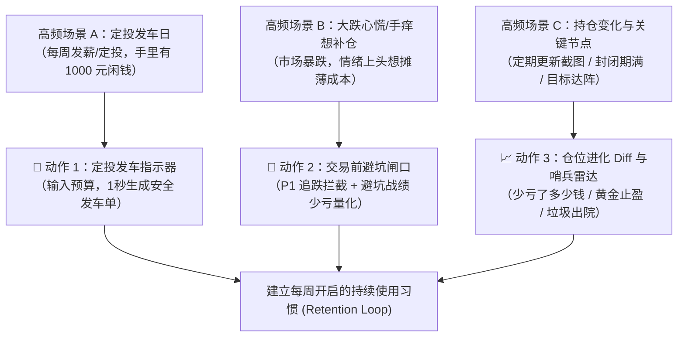

# 《ethan-hold 仓位罗盘：从“静态体检”到“高频副驾驶”重构 PRD 与实施方案》

> **产品代号**：`ethan-hold 2.0 (The Co-pilot Pivot)`  
> **核心战略转折**：彻底终结“看一眼就走、看完毫无后续动作”的静态体检报告，转型为**“发工资时带你买对、大跌时帮你少亏、该跑时叫你下车”的高留存投资副驾驶**。

---

## 1. 目标描述与战略背景 (Goal Description)

### 1.1 现状死穴：体检报告陷阱 (The Health Checkup Dilemma)
当前 `ethan-hold 1.0` 已经具备了业内顶尖的底层资产穿透、QDII 影子集群识别、硬顶熔断和高占比宏观背景前瞻能力。然而，在真实基民日常中，它的产品形态本质上是一份**“事后病理体检报告”**：
- 用户上传截图，看一眼：“哦，我买了 6 只影子纳指，我的黄金占了 24%，我的财通稳进亏了 15% 成了瑕疵资产”；
- 看完之后呢？用户的资产不会自动变好，下周发了工资他依然不知道手里的 1,000 块该买哪只，市场大跌时他依然会凭情绪在天天基金上狂按“补仓”；
- **结果**：看一次很惊艳，看两次无新意，看三次直接流失，无法建立长久的使用粘性。

### 1.2 核心使命：重塑基民三大高频动作循环
要让用户持续使用，产品必须死死卡在基民真实的**三大高频资金与情绪触发点**上：


---

## 2. 需要用户评审的关键决策 (User Review Required)

> [!IMPORTANT]
> **评审项 1：定投发车算法的“强制再平衡”策略**  
> 当用户输入例如“本周定投 1,000 元”时，系统将默认优先把资金打入**防守垫不足的板块（纯债、低波红利）**，对已达到硬顶警戒线的板块（如泛科技已超标、黄金已超 24%、深度套牢标的）**执行绝对零分配（0元）**。这是否符合你对“纪律性投资发令枪”的预期？

> [!IMPORTANT]
> **评审项 2：多版本历史追踪（History Tracking）的本地存储方案**  
> 为了保持“100% 离线、零外部数据库、零网络上报”的隐私铁律，多期持仓历史将保存在 Skill 根目录下的本地单文件 JSON（`data/portfolio_history.json`）。每次生成看板时，自动比对最新一期与上一期，计算科技敞口变化与“避坑战绩”。

> [!WARNING]
> **评审项 3：HTML 看板架构拓展（从 5 个 Tab 扩充为 7 个 Tab）**  
> 保持全局 Light Mode 清爽浅灰与纯白卡片，新增：
> - **Tab 6: 🚀 每周定投发车台 (DCA Dispatcher)**：交互式滑块调节定投金额，动态输出发车清单；
> - **Tab 7: 📈 进化轨迹与避坑战绩 (Health Timeline & Saved Loss)**：展示多版本指标演进走势，以及被拦截冲动操作后“实际帮你少亏了多少钱”。

---

## 3. 待澄清问题 (Open Questions)

> [!NOTE]
> 1. **发车周期的默认建议**：国内普通基民最常用的定投节奏是“周定投（如周二/周四）”还是“月定投（发工资后）”？目前计划在界面提供“按周 / 按月”快速切换预设（如周投 ¥500、月投 ¥2,000）。
> 2. **避坑战绩的基准设定**：当系统成功拦截用户冲动买入某只深度浮亏基金（如财通稳进增益）后，避坑少亏金额默认以“该标的过去 5 个交易日的跌幅”作为测算基准，向用户展示“因未加仓而少亏的真金白银”。

---

## 4. 详细实施计划与代码改动 (Proposed Changes)

### 4.1 新建核心计算与数据模块

#### [NEW] `scripts/dca_planner.py`
定投发车决策算法引擎。根据当前持仓穿透结构、三级硬顶限额和目标资产配置模型（如 40% 防守 + 30% 核心宽基/红利 + 30% 科技/QDII），计算增量资金的最佳分配方案。
- **输入**：当前持仓分析结果、定投总预算（如 `budget = 1000`）；
- **规则**：
  1. 标的自身浮亏 $\le -10.0\%$：硬顶冷冻，分配权重 $0\%$；
  2. 标的所属大类已超过硬顶（如泛科技 $\ge 50\%$ 或黄金 $\ge 24\%$）：分配权重 $0\%$；
  3. 防守垫（纯债/现金）比例低于 30%：优先将 $50\% \sim 70\%$ 资金分配给真纯债（天弘同利中短债）和红利低波；
  4. 纳指 100 并联集群：若合规允许加仓，只将额度分配给 1 只单只费率最低的龙头标的（广发纳指），影子代码分配 $0\%$；
- **输出**：结构化定投发车执行单（Fund Code, Name, Amount, Action Reason）。

#### [NEW] `scripts/history_tracker.py`
本地持仓多版本快照与差分进化追踪引擎。
- 负责维护本地 `data/portfolio_history.json`；
- 记录每次执行体检或加仓的时间戳、总市值、盈亏、各大赛道敞口、并联冗余数；
- 计算并输出两期版本 Diff（Delta）：
  - 泛科技敞口变化（如 `33.47% -> 29.10% (-4.37%)`）；
  - 纯债防守垫变化（如 `12.1% -> 18.5% (+6.4%)`）；
  - 避坑战绩（拦截冲动买入记录库，回溯计算“少亏金额”）。

#### [NEW] `scripts/slice_image.py`
手机长截图自适应滑窗切片与防幻觉预处理器 (Adaptive Tile Slicing)。
- **解决痛点**：手机滚动截屏（高宽比 > 2.0，通常 1:8~1:12）直接上传时，被客户端/模型视口等比缩放至 104px 宽，汉字萎缩成 3x3 像素黑块诱发严重拼合幻觉；
- **核心机制**：自动检测图片宽高比，对长图按 1:1.6 黄金比例自适应切成 2~5 张高分辨率局部切片，并保留 15% 垂直冗余重叠带；
- **联动流**：分块识别后提取 6 位基金代码反查官方字典，最后通过基金代码进行行级去重合并。

#### [NEW] `scripts/sentinel.py`
关键事件哨兵与出院倒计时管理模块。
- **黄金止盈哨兵**：监控建信上海金仓位占比与金价偏离度，当占比逼近 28% 时触发阶梯减仓预警；
- **瑕疵资产出院哨兵**：监控融通稳信增益 6 个月封闭期剩余天数、反弹净值目标线（-8%），提供倒计时进度条；
- **QDII 额度与纳指限购哨兵**：跟踪外汇额度松紧状态，一旦有龙头基金放开限额，提示影子归集。

---

### 4.2 现有模块改造与联动

#### [MODIFY] `scripts/run_analysis.py`
- 新增命令行参数：
  - `--dca AMOUNT`：指定定投预算，终端直接输出极简【本周定投发车单】；
  - `--save-snapshot`：自动将本次分析存入历史轨迹库；
  - `--diff [N]`：对比最新持仓与第 N 期历史持仓的健康度变化；
  - `--sentinel`：输出哨兵雷达警报。
- 在控制台摘要中输出定投发车单与哨兵状态。

```python
# 核心伪代码示例
parser.add_argument("--dca", type=float, help="输入定投预算(元)，生成定投发车安全检查单")
parser.add_argument("--snapshot", action="store_true", help="保存本次分析至历史追踪库")
parser.add_argument("--diff", action="store_true", help="输出与上一期历史持仓的对比进化")
```

#### [MODIFY] `templates/dashboard_template.html` & `scripts/generate_dashboard.py`
- **Tab 6: 🚀 每周定投发车台 (DCA Dispatcher)**：
  - 顶部预算输入框（快捷预设 ¥500、¥1,000、¥2,000、自定义）；
  - 动态渲染出表格：
    - 🟢 【建议买入】：分配具体金额、当前估值状态、推荐理由；
    - 🔴 【强制刹车】：本期 0 配额基金清单，明确标出拦截理由（“浮亏超标冷冻”、“赛道超限”、“并联冗余影子”）；
    - 一键生成“手机备忘录复制文本”，方便用户在支付宝/天天基金直接按单买入。
- **Tab 7: 📈 进化轨迹与避坑战绩 (Health Timeline)**：
  - 原生 SVG 历史折线图（展示泛科技敞口从超标到受控的压降曲线）；
  - **避坑少亏功劳簿**：“截至目前，罗盘共为您拦截 3 次冲动买入，实打实少亏 ¥426.50”。
- **首页 Tab 1 增强**：
  - 顶部插入【🚨 关键事件哨兵雷达】紧凑卡片（黄金止盈距离、财通封闭期倒计时）。

#### [MODIFY] `SKILL.md` & `README.md`
- 围绕“定投发车”、“避坑战绩”和“哨兵出院”重写作战清单与使用说明。

---

## 5. 验证与测试方案 (Verification Plan)

### 5.1 自动化测试 (Automated Tests)
- 新增 `tests/test_dca_planner.py`：测试各种预算（¥300、¥1,000、¥10,000）下的定投配比，确保浮亏超标和科技超标标的一律获得 0 配额；
- 新增 `tests/test_history_tracker.py`：测试多版本快照读写、Diff 差分算法计算与避坑战绩推演；
- 新增 `tests/test_sentinel.py`：测试哨兵阈值触发与倒计时逻辑；
- 更新 `tests/test_dashboard.py`：断言 Tab 6、Tab 7 的 DOM 结构、原生 SVG 渲染与 Light Mode 规范；
- 目标：所有测试套件通过率 **100%**。

### 5.2 真实实盘与端到端手动验收 (Manual Verification)
1. **定投发车验证**：
   - 运行 `python3 scripts/run_analysis.py -i portfolio_ethan_real.json --dca 1000`；
   - 检验终端输出的定投单中，财通稳进、银华光伏、纳指并联影子是否被 100% 拒绝，资金是否精准分流至红利低波与纯债。
2. **HTML 看板交互验收**：
   - 双击打开 `portfolio_dashboard.html`，切换至【🚀 每周定投发车台】；
   - 拖动预算滑块至 ¥2,000，检验下方发车清单是否动态联动重算，点击“复制发车单”检查剪贴板；
   - 切换至【📈 进化轨迹与避坑战绩】，检验历史趋势图与少亏战绩卡片。
3. **视觉铁律验收**：
   - 确认整套界面维持清爽明亮浅底色系（Light Mode，`#f6f8fa` 底色与纯白卡片，零外部 CDN）。
